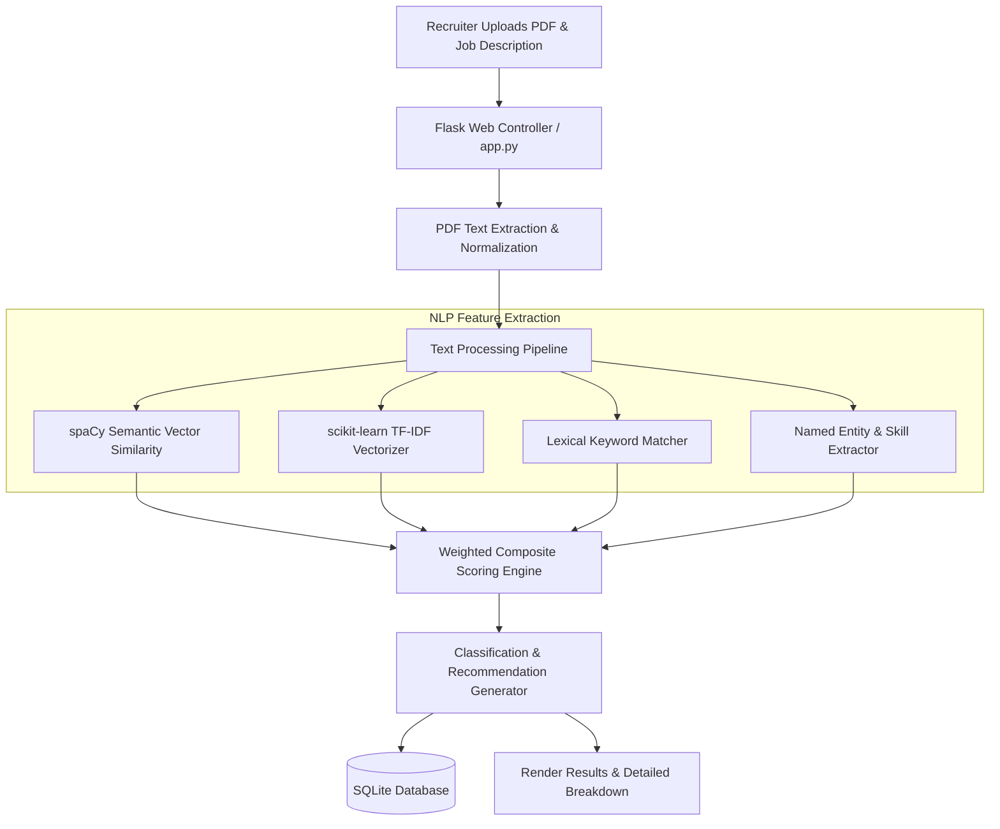

<div align="center">

# AI Resume Screening System

### Intelligent NLP-driven applicant screening, multi-dimensional semantic matching, and HR decision support.

[](https://www.python.org/)
[](https://flask.palletsprojects.com/)
[](https://spacy.io/)
[](https://scikit-learn.org/)
[](https://www.sqlite.org/)
[](https://ai-resume-screening-system-app.vercel.app)

[**Live Demo**](https://ai-resume-screening-system-app.vercel.app) · [**Overview**](#overview) · [**Scoring Engine**](#scoring-methodology) · [**Architecture**](#system-architecture) · [**Setup**](#installation--setup) · [**Limitations**](#limitations--status)

</div>

---

## Overview

High-volume talent acquisition often requires manually reviewing hundreds of resumes against diverse job descriptions—a process prone to fatigue, keyword bias, and inconsistency.

The **AI Resume Screening System** is an NLP-powered application that evaluates candidate resumes against target job specifications. Rather than relying on simple keyword counting, the platform analyzes underlying semantic context, technical skill profiles, education relevance, and experience language to calculate an objective match score with actionable HR interview recommendations.

---

## Key Capabilities

- **Automated PDF Parsing:** Extracts and normalizes unstructured text from uploaded PDF resumes.
- **Multi-Method NLP Matching:** Evaluates candidates across semantic similarity, term frequency relevance, keyword overlap, and domain entity extraction.
- **Skill & Competency Recognition:** Automatically identifies and categorizes 60+ technical and soft skills.
- **Objective Candidate Classification:** Tiers candidates into *Outstanding*, *Good*, *Potential*, *Low*, or *Not Suitable*.
- **Sentiment & Tone Analysis:** Assesses candidate tone and communication style using TextBlob.
- **Persistent Screening History:** Stores previous evaluations, candidate summaries, and score breakdowns in an embedded SQLite database.
- **Structured HR Recommendations:** Generates clear interview guidance and skill gap summaries for hiring teams.

---

## Scoring Methodology

The overall match score (0–100%) is computed through a weighted combination of four complementary NLP techniques:

```
Final Match Score = (Semantic Similarity × 0.40) + (TF-IDF Match × 0.30) + (Keyword Overlap × 0.20) + (Entity Matching × 0.10)
```

| Technique | Weight | Purpose & Implementation |
|---|:---:|---|
| **Semantic Similarity** | **40%** | Measures conceptual alignment using **spaCy** medium word vectors (`en_core_web_md`), ensuring candidates with synonymous phrasing are fairly recognized. |
| **TF-IDF Relevance** | **30%** | Leverages **scikit-learn** to measure the cosine similarity of high-importance job description tokens across the resume text. |
| **Direct Keyword Overlap** | **20%** | Evaluates direct lexical correspondence between the job requirements and candidate profile. |
| **Named Entity Extraction** | **10%** | Identifies specific accredited degrees, universities, certifications, and technical proficiencies. |

### Classification Tiers

| Composite Score | Category | Recommended Action |
|---|---|---|
| **85% – 100%** | Outstanding Match | Fast-track to technical interview; strong candidate across all dimensions |
| **70% – 84%** | Good Match | Recommended for initial screening interview; review secondary skill gaps |
| **55% – 69%** | Potential Match | Consider for entry-level or adjacent positions; training may be required |
| **40% – 54%** | Low Match | Insufficient core alignment with required specifications |
| **< 40%** | Not Suitable | Significant qualification and experience mismatch |

---

## System Architecture



---

## Project Structure

```
AI_Resume_Screening_System_App/
├── app.py                  # Flask server application & route controllers
├── resume_processor.py     # NLP parsing, spaCy vector scoring, and TF-IDF calculation
├── database.py             # SQLite database models, initialization, and audit logging
├── requirements.txt        # Runtime dependencies
├── index.html              # Candidate submission and job description upload UI
├── results.html            # Score breakdown, skill analysis, and recommendation display
├── history.html            # Historical screening audit records view
├── base.html               # Shared layout template
├── style.css               # User interface stylesheet
└── main.js                 # Dynamic frontend interactions and file upload handling
```

---

## Installation & Setup

### 1. Clone the Repository

```bash
git clone https://github.com/moheezkiani01/AI_Resume_Screening_System_App.git
cd AI_Resume_Screening_System_App
```

### 2. Configure Virtual Environment

```bash
python -m venv venv
# Windows:
venv\Scripts\activate
# Linux/macOS:
source venv/bin/activate

pip install -r requirements.txt
```

### 3. Download NLP Models & Corpora

```bash
python -m spacy download en_core_web_md
python -c "import nltk; nltk.download('stopwords'); nltk.download('punkt')"
```

### 4. Run the Application

```bash
python app.py
```

Open your browser at `http://localhost:5000`.

---

## Limitations & Status

- **Format Scope:** Optimized for single and multi-page text-based PDF resumes; scanned image-only PDFs require an OCR preprocessing step.
- **Domain Focus:** Skill dictionaries are currently calibrated for software engineering, data science, and technology roles.
- **Human in the Loop:** Intended as an advisory screening tool for HR professionals; hiring decisions should incorporate comprehensive human evaluation.
